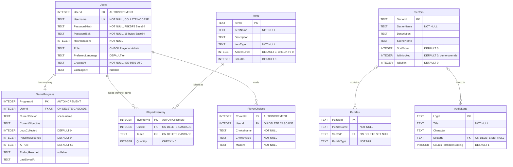
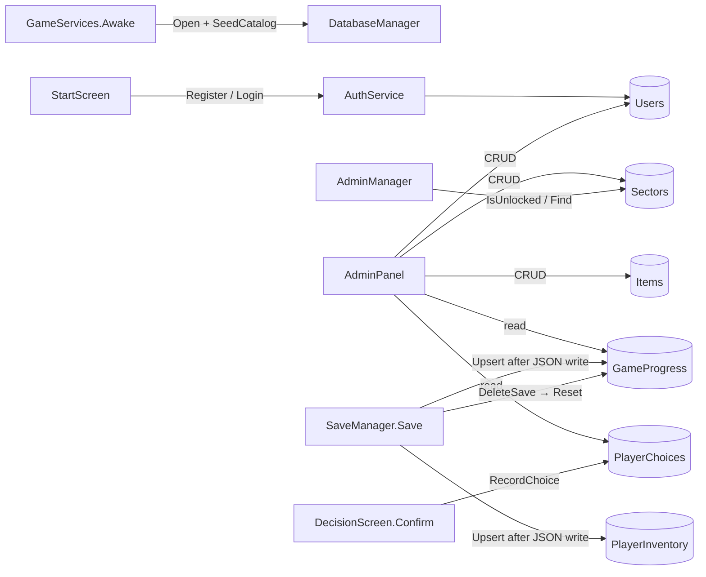
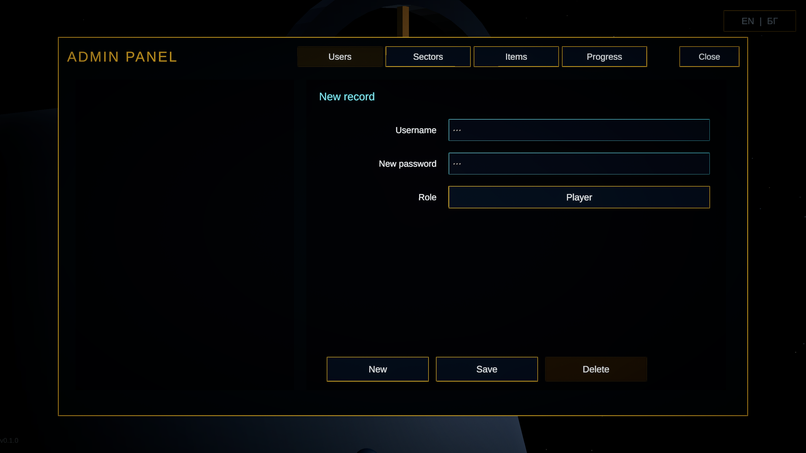

# The Last Signal — Database Schema

**Updated:** 2026-11-25 (matches `Assets/_Project/Scripts/Database/`, schema version 1).

| | |
|---|---|
| Engine | SQLite 3 through a small P/Invoke wrapper (`Sqlite.cs`: `SqliteConnection`, `SqliteRow`, `SqliteException`). macOS uses the system `libsqlite3`; Windows ships the official `sqlite3.dll` 3.54.1 (`Assets/Plugins/Windows/x86_64`). |
| File | `Application.persistentDataPath/lastsignal.db` (macOS: `~/Library/Application Support/LastSignal/The Last Signal/lastsignal.db`) |
| Owner | `DatabaseManager` — opens the file, runs migrations, seeds catalogues, exposes the repositories. It is the only place that contains SQL besides the repositories. |
| Versioning | `PRAGMA user_version` (`DatabaseManager.SchemaVersion = 1`). A newer file than the game refuses to open; older versions migrate step by step inside a transaction. |
| Integrity | `PRAGMA foreign_keys = ON` on every connection; `CHECK` constraints on roles, access level and quantities. |
| Safety | Every statement is parameterised (`:name` placeholders bound with `sqlite3_bind_*`); no SQL is built from user input. |
| Failure | If the file cannot be opened, `DatabaseManager.IsAvailable` is false, the game keeps running and account screens show `auth.err.no_database`. |

## 1. Role of the database (and what it does not store)

The JSON save file is the authoritative game state (see `TechnicalArchitecture.md` §6.5–6.6). The database holds:
- **accounts** (`Users`) for login, roles and the preferred language;
- **catalogues** (`Sectors`, `Items`, `Puzzles`, `AudioLogs`) seeded from the game content and editable by the administrator;
- a **per-user summary** (`GameProgress`, `PlayerInventory`, `PlayerChoices`) for the admin overview, derived from
  the JSON save after every successful write.

Design note (deviation from the spec): the spec put `IsCompleted` on `Puzzles` and `IsCollected` on `AudioLogs`. Those
are per-player facts — on global catalogue rows every account would share progress — so catalogues stay global and
per-player progress lives in the save and in `GameProgress`.

## 2. ER diagram



## 3. Tables

All `CREATE TABLE` statements are in `DatabaseManager.Migrate()` (version 0 → 1, one transaction).

### Users — accounts (CRUD 1)
| Column | Type | Constraints | Notes |
|---|---|---|---|
| `UserId` | INTEGER | PK AUTOINCREMENT | |
| `Username` | TEXT | NOT NULL UNIQUE COLLATE NOCASE | 3–20 chars `[A-Za-z0-9_.-]` (checked in `AuthService`) |
| `PasswordHash` | TEXT | NOT NULL | PBKDF2-HMAC-SHA256, 32 bytes, Base64 |
| `PasswordSalt` | TEXT | NOT NULL | random 16 bytes per user, Base64 |
| `HashIterations` | INTEGER | NOT NULL | 60 000 (`PasswordHasher.Iterations`); stored so it can be raised later |
| `Role` | TEXT | NOT NULL CHECK (`Player`, `Admin`) | enum `UserRole` |
| `PreferredLanguage` | TEXT | NOT NULL DEFAULT `'en'` | `en` / `bg`; applied at login, updated on language switch |
| `CreatedAt` | TEXT | NOT NULL | ISO-8601 UTC |
| `LastLoginAt` | TEXT | | set by `UserRepository.TouchLogin` |

### Sectors — station sectors (CRUD 2)
| Column | Type | Constraints | Notes |
|---|---|---|---|
| `SectorId` | TEXT | PK | `docking`, `engineering`, `medical`, `research`, `reactor` (+ admin-created rows) |
| `SectorName` | TEXT | NOT NULL | |
| `Description` | TEXT | | |
| `SceneName` | TEXT | | used by the admin teleport (`AdminManager.Teleport`) |
| `SortOrder` | INTEGER | NOT NULL DEFAULT 0 | |
| `IsUnlocked` | INTEGER | NOT NULL DEFAULT 0 | 1 = demo override: the hatch into this sector opens for everyone (`AdminManager.OverridesAccessTo`) |
| `IsBuiltIn` | INTEGER | NOT NULL DEFAULT 0 | 1 for the five seeded sectors; `SectorRepository.Delete` only deletes rows with `IsBuiltIn = 0` |

### Items — item catalogue (CRUD 3)
| Column | Type | Constraints | Notes |
|---|---|---|---|
| `ItemId` | TEXT | PK | `item_flashlight`, `item_fuse_30a`, `item_power_coupling`, `item_keycard_research`, `item_keycard_core` |
| `ItemName` | TEXT | NOT NULL | English name from the localization table at seeding |
| `Description` | TEXT | | |
| `ItemType` | TEXT | NOT NULL | `ItemType` enum: Tool, Component, Keycard, Battery, Document |
| `AccessLevel` | INTEGER | NOT NULL DEFAULT 0 CHECK (≥ 0) | used by the `AccessLevelAtLeast` condition |
| `IsBuiltIn` | INTEGER | NOT NULL DEFAULT 0 | 1 for seeded items |

### Puzzles — puzzle catalogue (read-only reference)
| Column | Type | Constraints |
|---|---|---|
| `PuzzleId` | TEXT | PK |
| `PuzzleName` | TEXT | NOT NULL |
| `SectorId` | TEXT | FK → `Sectors.SectorId` ON DELETE SET NULL |
| `PuzzleType` | TEXT | NOT NULL |

Seeded from `DatabaseManager.BuiltInPuzzles`: `dock_fusebox` (ItemSocket), `eng_generator_start` (Sequence),
`eng_power_routing` (Routing). The later puzzles (Medical PIN, Research decode, Reactor balance) are not in this
catalogue yet; their state lives in WorldState like every puzzle.

### AudioLogs — audio log catalogue (read-only reference)
| Column | Type | Constraints | Notes |
|---|---|---|---|
| `LogId` | TEXT | PK | 14 logs from `GameContent.AudioLogs` |
| `Title` | TEXT | NOT NULL | English title |
| `Character` | TEXT | | speaker |
| `SectorId` | TEXT | FK → `Sectors.SectorId` ON DELETE SET NULL | |
| `CountsForHiddenEnding` | INTEGER | NOT NULL DEFAULT 1 | Ending C needs all 14 |

### GameProgress — one summary row per player
| Column | Type | Constraints | Notes |
|---|---|---|---|
| `ProgressId` | INTEGER | PK AUTOINCREMENT | |
| `UserId` | INTEGER | NOT NULL UNIQUE, FK → `Users` ON DELETE CASCADE | one row per user (upsert `ON CONFLICT(UserId)`) |
| `CurrentSector` | TEXT | | scene name of the last save |
| `CurrentObjective` | TEXT | | objective id, e.g. `obj_05` |
| `LogsCollected` | INTEGER | NOT NULL DEFAULT 0 | |
| `PlaytimeSeconds` | INTEGER | NOT NULL DEFAULT 0 | |
| `AiTrust` | INTEGER | NOT NULL DEFAULT 50 | CAIRN trust from the save |
| `EndingReached` | TEXT | | `choice.final` from the save (`destroy` / `restore` / `silence`) |
| `LastSavedAt` | TEXT | | ISO-8601 UTC |

### PlayerInventory — mirror of the latest save's inventory
| Column | Type | Constraints |
|---|---|---|
| `InventoryId` | INTEGER | PK AUTOINCREMENT |
| `UserId` | INTEGER | NOT NULL, FK → `Users` ON DELETE CASCADE |
| `ItemId` | TEXT | NOT NULL, FK → `Items` ON DELETE CASCADE |
| `Quantity` | INTEGER | NOT NULL CHECK (> 0) |
| | | UNIQUE (`UserId`, `ItemId`) |

Rewritten in the same transaction as `GameProgress`; only items that exist in `Items` are mirrored.

### PlayerChoices — decisions log
| Column | Type | Constraints | Notes |
|---|---|---|---|
| `ChoiceId` | INTEGER | PK AUTOINCREMENT | |
| `UserId` | INTEGER | NOT NULL, FK → `Users` ON DELETE CASCADE | |
| `ChoiceName` | TEXT | NOT NULL | `final_decision`, `ai_trust_at_end` |
| `ChoiceValue` | TEXT | NOT NULL | e.g. `restore`, `65` |
| `MadeAt` | TEXT | NOT NULL | ISO-8601 UTC |

Written by `DecisionScreen.Confirm()` when the player confirms the final decision (real accounts only).

## 4. Code map

| Class | Responsibility |
|---|---|
| `DatabaseManager` | `Open(path)`, `Migrate()`, `SeedCatalog(GameContent, englishText)` (`INSERT OR IGNORE`, never overwrites admin edits), `BuiltInSectors`, `BuiltInPuzzles`, repositories `Users`, `Sectors`, `Items`, `Progress` |
| `UserRepository` | `Create`, `FindById`, `FindByName`, `All`, `Count`, `CountAdmins`, `UpdateUsername`, `UpdateRole`, `UpdatePassword`, `UpdateLanguage`, `TouchLogin`, `Delete` |
| `SectorRepository` | `Create`, `Find`, `All`, `Update`, `SetUnlocked`, `IsUnlocked`, `Delete` (custom rows only) |
| `ItemRepository` | `Create`, `Find`, `All`, `Update`, `Delete` |
| `ProgressRepository` | `Upsert(ProgressRecord, inventory)`, `Find`, `RecordChoice`, `Choices`, `Reset` |
| Records | `UserRecord`, `SectorRecord`, `ItemRecord`, `ProgressRecord`, enum `UserRole` |
| `AuthService` | `Register`, `Login`, `Logout`, `CanDelete`, `CanChangeRole`, `ChangePassword`, `NeedsFirstAdmin`; results are localization keys (`auth.err.*`) |
| `PasswordHasher` | `Hash` / `Verify` (PBKDF2-HMAC-SHA256, constant-time comparison) |

Who writes what:



## 5. Account rules and admin CRUD

- First run: when no administrator exists (`AuthService.NeedsFirstAdmin`), Settings → *Administrator* shows a form
  that creates the first `Admin` account; afterwards the same page is a login.
- Registration: unique user name (case-insensitive), 3–20 characters, password ≥ 6 characters, confirmation must match.
- Login: the same error for an unknown user and a wrong password (`auth.err.invalid_login`, no account enumeration).
- Admin panel (`AdminPanel`, tabs **Users / Sectors / Items / Progress**): create / read / update / delete for the first
  three, read-only Progress (summary + decisions). Every action re-checks the admin role; delete needs a second click.
  Guards: you cannot delete your own account; the last administrator cannot be deleted or demoted; built-in sectors
  cannot be deleted; a duplicate id is refused (`ui.admin.err_exists`).



## 6. Seeding

`GameServices.Awake()` → `DatabaseManager.Open()` → `SeedCatalog()` with English names from `en.json`:
5 sectors (`BuiltInSectors`), the 5 items and 14 audio logs from `Resources/GameContent.asset`, and 3 puzzles
(`BuiltInPuzzles`). `INSERT OR IGNORE` makes seeding safe on every start and keeps admin edits.

## 7. Useful queries (for the defence)

```sql
-- accounts and roles
SELECT UserId, Username, Role, PreferredLanguage, LastLoginAt FROM Users ORDER BY Role DESC, Username;
-- where every player is
SELECT u.Username, g.CurrentSector, g.CurrentObjective, g.LogsCollected, g.AiTrust, g.EndingReached
FROM Users u LEFT JOIN GameProgress g ON g.UserId = u.UserId;
-- final decisions
SELECT u.Username, c.ChoiceName, c.ChoiceValue, c.MadeAt FROM PlayerChoices c JOIN Users u ON u.UserId = c.UserId;
```
Run with `sqlite3 ~/Library/Application\ Support/LastSignal/The\ Last\ Signal/lastsignal.db`.
