# The Last Signal — Technical Architecture

**Updated:** 2026-11-25 (matches the code on `main`). Source of truth for system boundaries; the original spec is
`The_Last_Signal_Master_Plan.md`. Changes to a public API or data contract are recorded in `DecisionsLog.md`.

Engine: **Unity 6.3 (6000.3.10f1)**, Universal Render Pipeline, Input System, TextMeshPro. Platforms: macOS
(Apple Silicon) and Windows x64. Code: 121 C# files in `Assets/_Project/Scripts/` (two assemblies, §9).

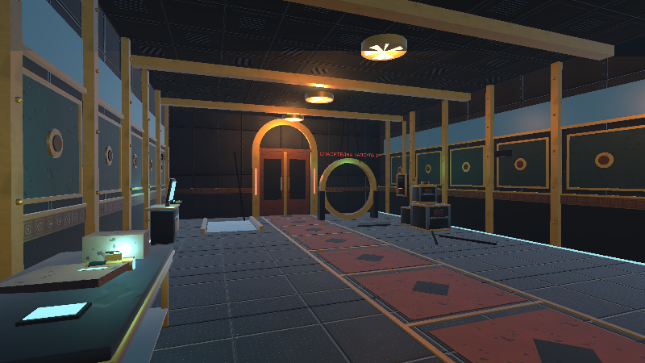

## 1. Guiding idea

One small, explicit **world state** holds every fact that progression depends on. Gameplay objects (doors, puzzles,
quests, dialogue) never talk to each other directly — they read **conditions** against that state and write
**effects** (facts) into it. Save/load then only has to serialise world state + inventory + the player's pose.

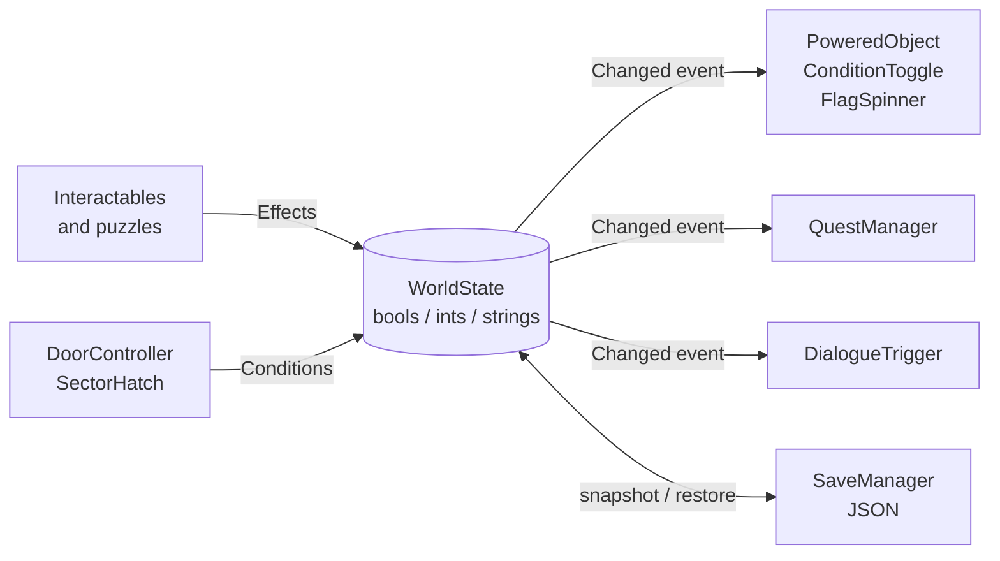

## 2. Module and dependency overview

All runtime code is in the `LastSignal.Runtime` assembly, split into namespaces by folder. `GameServices` is the
composition root: it creates every manager and exposes it as `GameServices.X` (one access point, no scattered
singletons). Arrows mean "uses / calls" and were checked against the `using LastSignal.*` references in each folder.

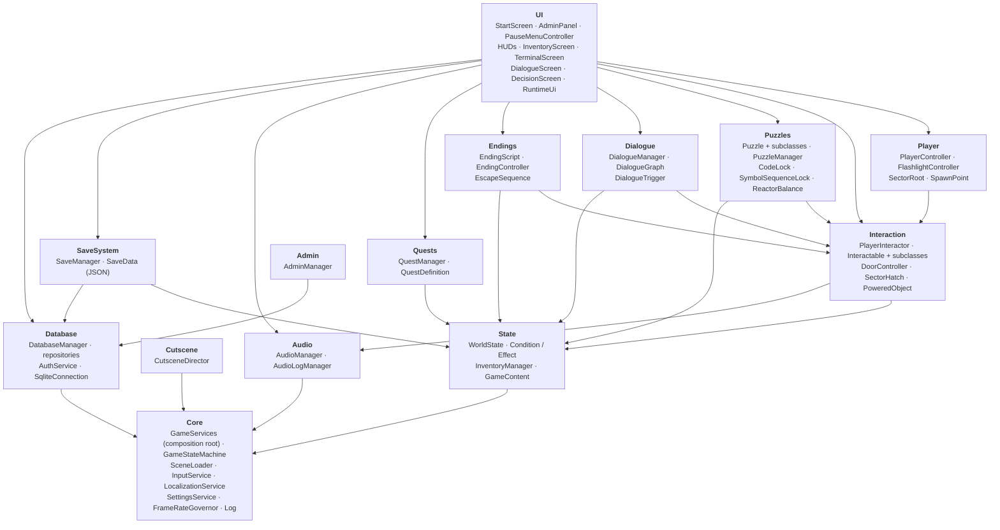

Rules and the known exceptions:
- Lower layers never hold references to UI objects. Three narrow exceptions exist and are deliberate:
  `ConsoleDialogueInteractable` raises `DecisionScreen.RequestOpen()` (a static request, the screen listens),
  `LiftInteractable` shows a toast through `HudController`, and `EscapeSequence` builds its countdown label with
  `RuntimeUi`.
- `Core/State/Conditions.cs` knows `ItemDefinition`/`InventoryManager` because `HasItem` is a condition type.
- Only `DatabaseManager` and the repositories contain SQL; only `SaveManager` touches save files.
- `GameServices` may reference every system; systems reach each other only through `GameServices.X` or events.

## 3. Scenes and scene flow

| Scene (`SceneIds`) | Path | Purpose |
|---|---|---|
| `Bootstrap` | `Scenes/Bootstrap/` | Build index 0. `BootstrapEntry` sets `GameState.Boot` and loads `MainMenu` (or the `-startScene` argument). |
| `MainMenu` | `Scenes/MainMenu/` | `StartScreen` (New game / Load game / Settings / Quit, administrator inside Settings), `AdminPanel`, `SlowOrbitCamera` backdrop. |
| `Cutscene_Opening` | `Scenes/Cutscenes/` | `CutsceneDirector` plays the 14-shot list "The Call"; hold Space/Esc to skip; then loads the Docking Bay. |
| `Sector_DockingBay` | `Scenes/Station/` | Tutorial: flashlight, fuse, fuse box, breaker, inner door. Also the end of the Ending A escape (board the Tern). |
| `Sector_Engineering` | `Scenes/Station/` | Coupling, generator start sequence, power-routing board (Array feed temptation). |
| `Sector_Medical` | `Scenes/Station/` | Pod 3 nameplate, patient terminal PIN, confiscated cabinet → research keycard. |
| `Sector_Research` | `Scenes/Station/` | Response Trials board, Trial 7 symbol decode, safe → core keycard. |
| `Sector_ReactorCommand` | `Scenes/Station/` | Reactor shaft (valve balance) and Command Center 20 m above (lift); captain's console → decision; service tunnel for Ending A. |
| `Ending` | `Scenes/Endings/` | `EndingController`: ending lines by trust, visual event, epilogue, credits → main menu. |

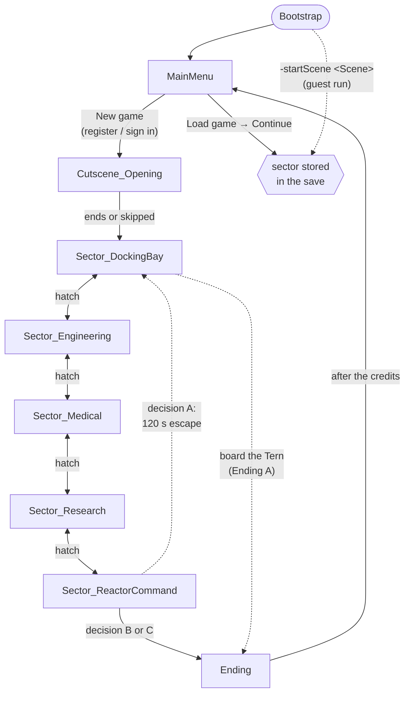

From every sector the pause menu's *Main menu* returns to `MainMenu`. How a scene change works:
- `SceneLoader.Load(scene, spawnId)` fades out, loads with `LoadSceneMode.Single`, fades in. Persistent services survive
  because `GameServices` is `DontDestroyOnLoad` and is created by `[RuntimeInitializeOnLoadMethod(BeforeSceneLoad)]` —
  so any scene can be opened and played directly in the Editor.
- Each sector has one `SectorRoot`: it spawns the player prefab at `SceneLoader.PendingSpawnId` (or applies the pose
  from `SaveManager.PendingRestore` after *Continue*), sets `sector.<id>.visited`, switches to `GameState.Playing` and
  autosaves (`GameServices.Checkpoint()`).
- `SectorHatch` (an `Interactable`) loads another sector at a named spawn point; `LiftInteractable` moves the player
  inside one scene (reactor ↔ Command).

## 4. Systems and responsibilities

All managers are created in `GameServices.Awake()` (in this order) and reached as `GameServices.X`.

| System | Folder | Responsibility | Does NOT |
|---|---|---|---|
| `GameServices` | Core | Composition root; `StartNewRun()` (clears world + inventory, trust = 50); `Checkpoint()` autosave. | Contain gameplay rules. |
| `GameStateMachine` | Core | States `Boot / MainMenu / Cutscene / Playing / InMenu / Paused / Ending`; owns cursor lock and time scale. | Load scenes. |
| `SceneLoader` | Core/Scenes | Async single-scene loads behind a fade, pending spawn id; `SceneIds` constants. | Decide which scene. |
| `BootstrapEntry` | Core/Scenes | First scene logic; `-startScene <Scene>` and `-quitAfterSeconds <s>` arguments. | — |
| `InputService` | Core/Input | Owns the generated `LastSignalControls`; Player + Interaction maps only while `Playing`. | — |
| `LocalizationService`, `Loc`, `LocalizedText` | Core/Localization | EN/BG tables, `Get(key, args)`, `LanguageChanged` event, language saved in PlayerPrefs (`ls.language`). | Keep text in code. |
| `SettingsService` | Core | Mouse sensitivity, invert Y, master volume, quality level (Low/Medium/High, default Medium) in PlayerPrefs. | — |
| `FrameRateGovernor` | Core | Frame cap: 60 fps playing, 30 in menus/pause, 10 when the window is unfocused. | — |
| `GameContent` | Core | ScriptableObject registry (`Resources/GameContent.asset`) of items, audio logs, quests, terminals; resolves ids. | — |
| `WorldState`, `WorldKeys`, `SectorIds` | Core/State | Typed facts with `Changed(key)` / `Reset` events; canonical key builders. | Know about doors, quests… |
| `Condition`, `ConditionSet`, `Effect`, `Effects` | Core/State | Serialisable requirements and state changes used in builders (§6.2). | — |
| `Log` | Core | `Log.Info/Warn/Error(system, message)` with a `[System]` prefix. | — |
| `PlayerController` | Player | CharacterController walk/sprint/jump, mouse look, footstep events. | Interaction. |
| `FlashlightController` | Player | Toggle (F) once owned, battery drain/recharge, flicker; battery in `flashlight.battery`. | — |
| `SectorRoot`, `SpawnPoint`, `PlayerAudio` | Player | Spawn/restore the player; footsteps and UI sounds. | — |
| `PlayerInteractor` | Interaction | Camera ray-cast to an `IInteractable`, focus/prompt events, `Interact` on E. | Item-specific logic. |
| `Interactable` (+ subclasses) | Interaction | Prompt, `requirements` (ConditionSet), `effects`, one-shot memory (`story.used.<id>`), `UnityEvent`. | — |
| `DoorController`, `SectorHatch`, `LiftInteractable` | Interaction | Sliding doors (unlock remembered in `door.<id>.unlocked`), scene hatches, in-scene lift. | Inventory or quest logic. |
| `PoweredObject`, `ConditionToggle`, `FlagSpinner` | Interaction | Pure views of world facts (lights on power, frost/wiped glass, spinning machines). | Hold state. |
| `InventoryManager`, `ItemDefinition` | Inventory | Add/remove/has, selection, snapshot (id → quantity), change events. | UI. |
| `Puzzle` (abstract), `PuzzleManager` | Puzzles | Solved state = `puzzle.<id>.solved`; `onSolvedEffects`; global `PuzzleSolved`/`PuzzleFailed` events (hook for listeners). | Puzzle-specific rules. |
| `QuestManager`, `QuestDefinition` | Quests | Sequential objectives; completion stored as `quest.<objectiveId>.done`; re-evaluates on world/inventory change. | UI layout. |
| `DialogueManager`, `DialogueGraph`, `DialogueTrigger`, `ConsoleDialogueInteractable` | Dialogue | Runs CAIRN conversations, choices with trust/flag effects, queueing; graphs remember `dlg.<id>.played`. | Rendering. |
| `AudioManager`, `SectorAmbience` | Audio | SFX, voices (`Voice/<lang>/<key>`), ambience cross-fades, ducking while someone speaks. | — |
| `AudioLogManager`, `AudioLogDefinition` | Audio | Collect/play the 14 audio logs with subtitle timelines (`log.<id>.collected`, `log.<id>.played`). | — |
| `CutsceneDirector`, `CutsceneShot`, `EmissionPulse`, `SequentialActivator` | Cutscene | Data-driven shot list with one camera, captions, skip. | — |
| `EndingScript`, `EndingController`, `EscapeSequence`, `BoardShipInteractable` | Endings | Ending A/B/C lines by trust; Ending A 120 s escape that survives scene loads. | — |
| `SaveManager`, `SaveData` | SaveSystem | JSON save per user, atomic write + `.bak`, version check, *Continue*; then updates the DB summary. | SQL. |
| `DatabaseManager`, repositories, `SqliteConnection` | Database | SQLite file, migrations (`PRAGMA user_version`), catalogue seeding, parameterised queries. | Game rules. |
| `AuthService`, `PasswordHasher`, `UserSession` | Database | Register/login/roles, PBKDF2 hashing, account rules. | UI. |
| `AdminManager` | Admin | Admin-only, session-only commands: unlock all doors, give all items, restore power, teleport; reads the `Sectors.IsUnlocked` demo override. | Write to a player's save. |
| `StartScreen`, `AdminPanel`, `PauseMenuController`, HUDs, `UiScreen`s, `RuntimeUi` | UI | All screens; listen to events and call public APIs. | Hold game state. |

### 4.1 Interaction subclasses
`PickupInteractable` (item → inventory, always one-shot), `ItemSocketInteractable` (consume an item, e.g. fuse box),
`LeverInteractable` (breaker), `AudioLogPickup`, `CrankInteractable` (`crank.<id>.turns`), `DoorController`,
`SectorHatch`, `LiftInteractable`, and in other folders `RoutingSocketInteractable`, `SequenceStepInteractable`,
`SymbolKeyInteractable`, `ValveInteractable`, `TerminalInteractable` (Puzzles), `ConsoleDialogueInteractable`
(Dialogue), `BoardShipInteractable` (Endings).

### 4.2 Puzzles (one per sector at least)
| Sector | Puzzle class | Rule | Logic class (unit-tested) |
|---|---|---|---|
| Docking | `ItemSocketInteractable` + `LeverInteractable` | fuse in the box, then the breaker | — |
| Engineering | `SequencePuzzle` (`eng_generator_start`) | coolant → fuel → ignition → load | — |
| Engineering | `RoutingBoard` (`eng_power_routing`) | exactly Medical, Life support, Lighting plugged (3 cables) | — |
| Medical | `TerminalDefinition` PIN lock (`terminal_<id>`) | PIN 0417 from Pod 3's nameplate | `CodeLock` |
| Research | `SymbolDecodePuzzle` | Trial 7 answer = the sent row mirrored | `SymbolSequenceLock` |
| Reactor | `ReactorBalancePuzzle` | three valves on three different settings | `ReactorBalance` |

## 5. Runtime sequence: routing board solved → power → door → autosave

Engineering's routing board, as built by `EngineeringBuilder.BuildRoutingBoard` (puzzle id `eng_power_routing`,
on-solved effects `SetSectorPower medical` + `story.eng_routed`; the corridor door `eng_medical_corridor` requires
`SectorPowered medical`; objective `obj_07` completes on `PuzzleSolved eng_power_routing`).

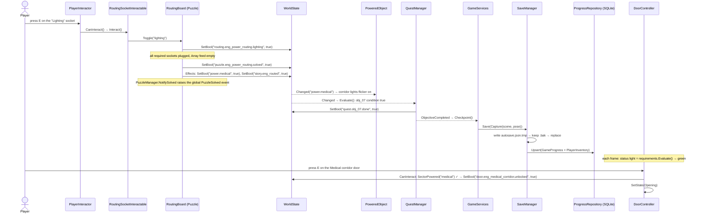

## 6. Shared data contracts

### 6.1 WorldState keys (lowercase, dot-namespaced; built through `WorldKeys`)
| Pattern | Type | Written by | Example |
|---|---|---|---|
| `power.<sectorId>` | bool | `Effect.Power` (breaker, generator, routing, reactor) | `power.docking` |
| `door.<doorId>.unlocked` | bool | `DoorController` on first open | `door.dock_inner.unlocked` |
| `puzzle.<puzzleId>.solved` | bool | `Puzzle.MarkSolved` | `puzzle.eng_power_routing.solved` |
| `quest.<objectiveId>.done` | bool | `QuestManager` | `quest.obj_07.done` |
| `log.<logId>.collected` / `.played` | bool | `AudioLogManager` | |
| `dlg.<graphId>.played` | bool | `DialogueManager` (once-only graphs) | `dlg.ai_dock_01.played` |
| `story.<flag>` | bool | effects, one-shots (`story.used.<id>`), endings | `story.has_flashlight`, `story.escape_active` |
| `routing.<puzzleId>.<socket>` | bool | `RoutingBoard` | |
| `crank.<id>.turns` | int | `CrankInteractable` | |
| `flashlight.battery` | int (%) | `FlashlightController` | |
| `choice.final` | string | `EndingScript.Commit` | `destroy` / `restore` / `silence` |
| `ai.trust` | int 0–100, start 50 | dialogue choice effects (`AddInt`, clamped) | |
| `sector.<sectorId>.visited` | bool | `SectorRoot` | |

Sector ids (`SectorIds`): `docking`, `engineering`, `medical`, `research`, `reactor`.

### 6.2 Conditions and effects (serialisable, set by the builders)
```csharp
[Serializable] public sealed class Condition { ConditionType type; string key; int value; string text; ItemDefinition item; string failReasonKey; }
// ConditionType: FlagTrue, FlagFalse, IntAtLeast, IntBelow, StringEquals, HasItem, SectorPowered, PuzzleSolved, LogCollected, AccessLevelAtLeast
[Serializable] public sealed class ConditionSet { bool requireAll = true; List<Condition> conditions; }
[Serializable] public sealed class Effect { EffectType type; string key; int value; string text; ItemDefinition item; }
// EffectType: SetFlag, ClearFlag, AddInt, SetInt, SetString, GiveItem, RemoveItem, SetSectorPower
```
A failing condition returns its `failReasonKey`, which the HUD shows (e.g. `prompt.door.no_power`).

### 6.3 Interaction contract
```csharp
public interface IInteractable {
    string GetPromptText();                                       // already localized, e.g. "Pick up Fuse"
    bool CanInteract(PlayerInteractor who, out string reasonKey);  // reasonKey = localization key or null
    void Interact(PlayerInteractor who);
    bool IsInteractionEnabled { get; }                            // false = invisible to the interactor
}
```
`Interactable.Interact` = `CanInteract` → `OnInteract` (subclass) → `Effects.ApplyAll(effects)` → one-shot flag → `onInteracted`.

### 6.4 Definitions (ScriptableObjects with stable string ids, registered in `GameContent`)
`ItemDefinition` (id, `ItemType` Tool/Component/Keycard/Battery/Document, nameKey, descriptionKey, icon, accessLevel,
stackable, inspectPrefab) · `AudioLogDefinition` (id, sectorId, titleKey, speakerKey, dateKey, EN + BG clip, subtitle
lines, critical, countsForHiddenEnding) · `QuestDefinition` (id, titleKey, sequential, `ObjectiveDefinition`s) ·
`TerminalDefinition` (entries + optional PIN lock) · `DialogueGraph` (id, startNode, once, `DialogueNode`s with
`DialogueChoice`s carrying conditions and effects). Content: 5 items, 14 audio logs, one main quest (`obj_01`–`obj_17a`).

### 6.5 Save file (JSON, `persistentDataPath/Saves/<userId>/autosave.json`)
```json
{ "version": 1, "userId": 3, "savedAtUtc": "2026-11-21T16:02:59Z", "scene": "Sector_Engineering",
  "playerPosition": [0, 0, 0], "playerYaw": 0, "playerPitch": 0,
  "inventory": { "item_flashlight": 1, "item_power_coupling": 1 },
  "world": { "Bools": {}, "Ints": { "ai.trust": 55 }, "Strings": {} },
  "playtimeSeconds": 75.0, "currentObjective": "obj_05", "logsCollected": 2 }
```
- Write: `autosave.json.tmp` → copy the old file to `.bak` → replace. Read: main file, else `.bak`.
- `version` newer than `SaveData.CurrentVersion` → refused with `save.err.newer_version`; unreadable → `save.err.corrupt`.
- Checkpoints: entering a sector (`SectorRoot`), every completed objective, the lift, the final decision, and the
  pause menu's *Save game*. No saves without a real account (guest / `-startScene` runs).

### 6.6 SQLite vs JSON (no overlap)
- **SQLite** (`persistentDataPath/lastsignal.db`): accounts, admin-editable catalogues and a per-user summary for the
  admin overview. See `DatabaseSchema.md`.
- **JSON**: the full resumable run state. JSON is authoritative; the DB summary is derived from it after each
  successful write and never read back into gameplay.
- `Sectors.IsUnlocked = 1` is a global demo override read by `SectorHatch` through `AdminManager.OverridesAccessTo`;
  it never writes into a player's JSON.

## 7. Localization
- Tables: `Assets/_Project/Localization/Resources/Localization/en.json` and `bg.json`, flat `{ "key": "text" }`,
  594 keys each. Prefixes: `ui.*`, `prompt.*`, `item.*`, `obj.*`, `log.*`, `dlg.*`, `terminal.*`, `cut.*`, `end.*`,
  `epi.*`, `auth.*`, `toast.*`, sector-specific (`eng.*`, `med.*`, `res.*`, `reactor.*`, `command.*`).
- `LocalizedText` on a TMP text re-renders on `LanguageChanged`; code uses `Loc.Get(key, args)`.
- Missing key → English → `#key#`, reported once. The account's `PreferredLanguage` is applied at login and updated
  when the player switches language.
- Voices: `Audio/Resources/Voice/en` and `/bg` (94 clips each), file name = localization key with `.` → `_`.
- Font: LiberationSans SDF with a dynamic Cyrillic fallback asset (its "Clear Dynamic Data On Build" must stay off;
  guarded by `GlyphRenderTests`).

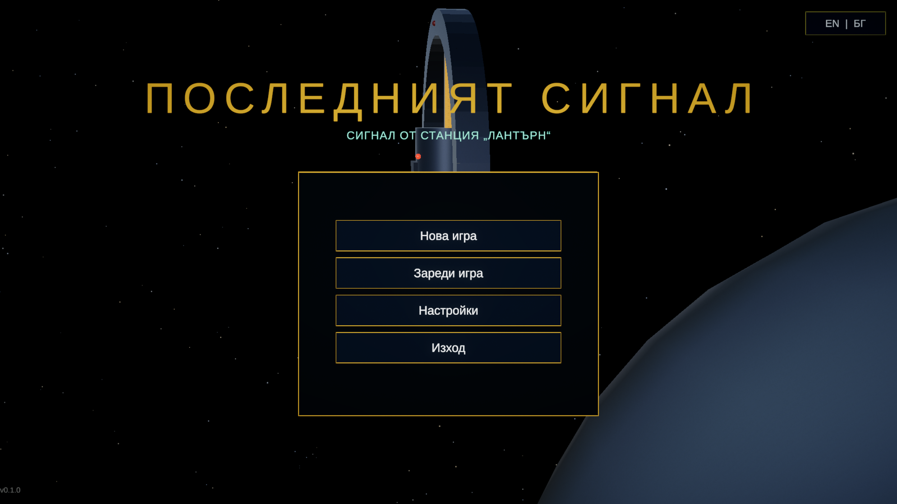

## 8. Input
One asset `Core/Input/LastSignalControls.inputactions` (generated class `LastSignalControls`):
- **Player:** Move (WASD), Look (mouse delta), Sprint (Left Shift), Jump (Space), Flashlight (F)
- **Interaction:** Interact (E), Inventory (Q), Pause (Esc)
- **UI:** Navigate, Submit, Cancel (Esc), Point, Click, RightClick, MiddleClick, ScrollWheel, ToggleInventory (Q)

`InputService.ApplyState` enables Player + Interaction only in `GameState.Playing`; UI is always on. Binding
overrides are saved to PlayerPrefs (`SaveBindingOverridesAsJson`).

## 9. Assemblies, content pipeline and tests
- **`LastSignal.Runtime`** (`Assets/_Project/Scripts`) — references Input System, TextMeshPro, UGUI, Timeline, URP.
- **`LastSignal.Editor`** (`Scripts/Editor`, Editor only, namespace `LastSignal.EditorTools`) — everything that
  *produces* the game. Scenes are never edited by hand:
  - Builders: `DockingBayBuilder`, `EngineeringBuilder`, `MedicalBuilder`, `ResearchBuilder`, `ReactorCommandBuilder`,
    `CutsceneBuilder`, `EndingBuilder`, `MainMenuBuilder`, `PlayerPrefabBuilder`; shared `BuilderKit`, `Ornament`, `Atmosphere`.
  - Content data: `DockingBayContent`, `EngineeringContent`, `StationContent`, `DialogueContent`, orchestrated by `ContentPipeline`
    (menu `Last Signal/Build Content/Build All Sectors`).
  - Art: `StationMaterials`, `StationTextures` (procedural painted textures + normal maps), `SkyArt` (Nereth, starfield),
    `PropModels` (places the Blender FBX props made by `Tools/blender/build_props.py`).
  - Setup and builds: `ProjectSetup`, `QualityPresets`, `AudioImportRules`, `BuildTools` (`Last Signal/Build/macOS`,
    `macOS (clean)`, `Windows`).
  - Diagnostics and dev tools: `DebugMenu` (`Last Signal/Debug/*`), `PerformanceReport`, `PreviewRenderer`, `UiPreview`,
    `DiagnosticSceneSplit`, `McpStdioBootstrap`.
- **Tests** (`Assets/_Project/Tests`): 28 EditMode (WorldState, conditions/inventory, quests/puzzle logic, database +
  hashing, ending script, frame-rate governor) and 93 PlayMode (full playthroughs of all endings in EN and BG, save/load
  in every sector, accounts, dialogue, audio, door clearance, interactable reachability, world-text fit, Cyrillic
  glyphs, materials, moving parts, performance budget). All green on 2026-11-21.

## 10. Error handling and logging
`Log.Info/Warn/Error(system, message)` prefixes `[System]`. Save and database failures are caught, logged and shown
to the player as a localized message (`save.err.*`, `auth.err.no_database`); if the database cannot be opened the
game still runs (no accounts). Missing audio clips are skipped silently (logged once).

## 11. Performance rules (MacBook M4)
One sector loaded at a time; `FrameRateGovernor` caps the frame rate; three URP quality presets (default Medium);
at most one shadow-casting lamp per room; texture import limits and audio import rules. Measurements and the
before/after numbers are in `Performance.md` and `PerformanceReport.txt`.

## 12. Screenshots

| | |
|---|---|
|  Docking Bay | 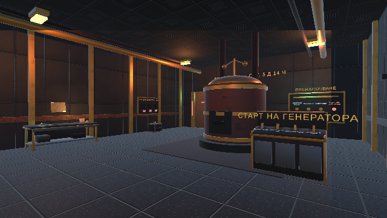 Engineering |
| 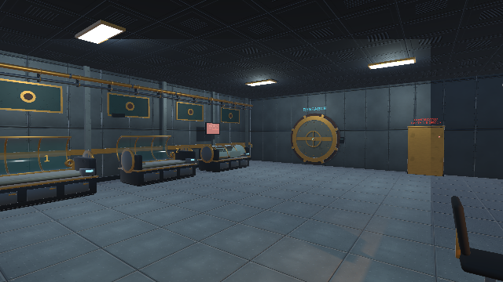 Medical Bay | 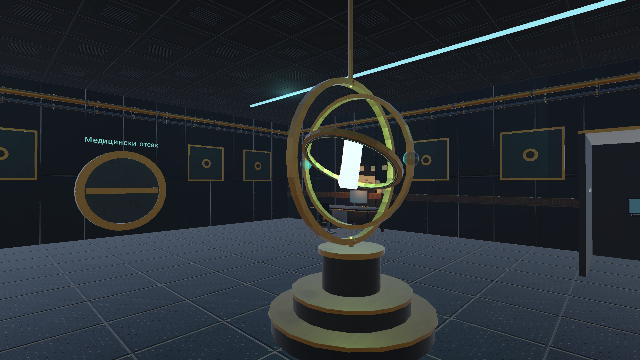 Research Laboratory |
| 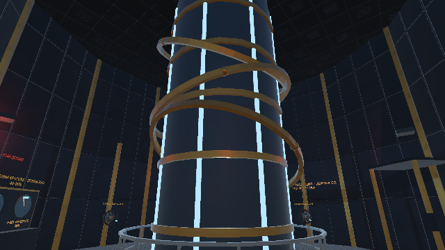 Reactor Core | 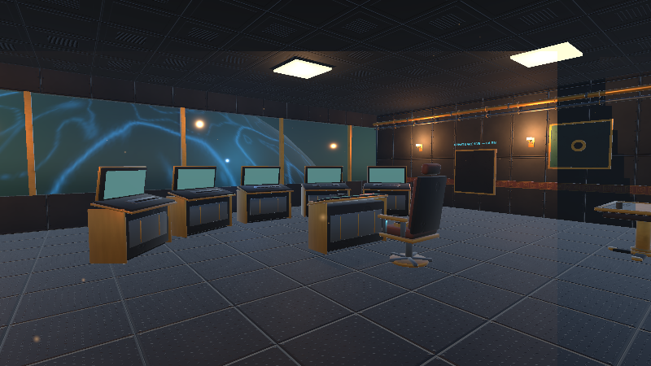 Command Center |
| 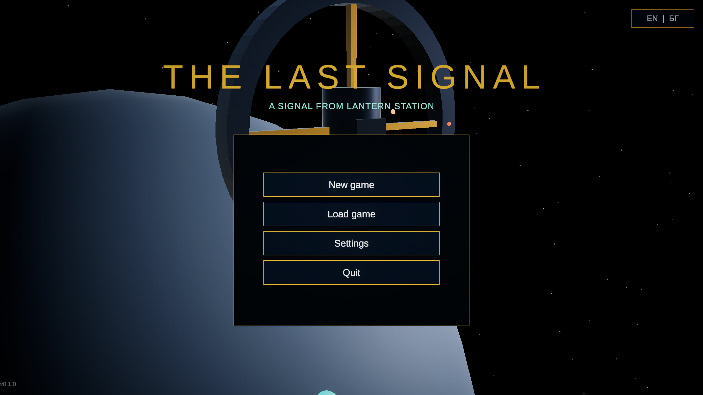 Main menu (EN) |  Main menu (BG) |
| 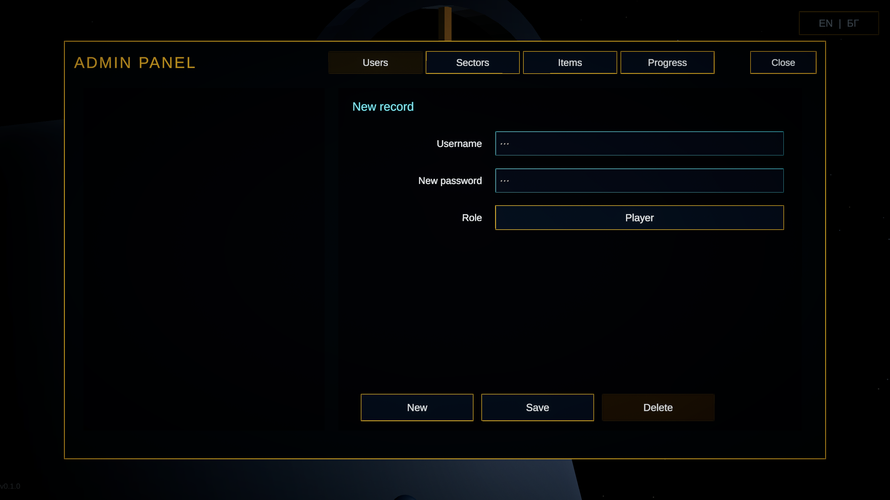 Admin panel | 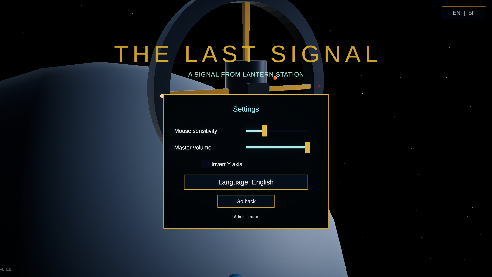 Settings |
| 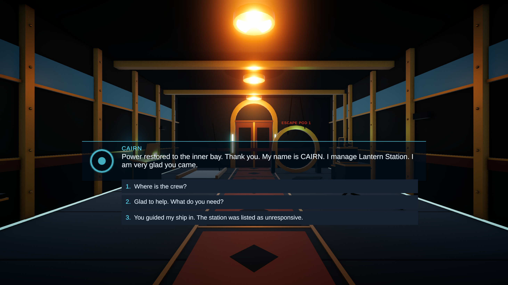 CAIRN dialogue with choices | 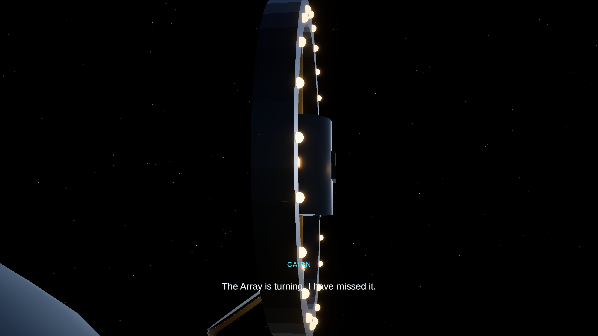 Ending B |
